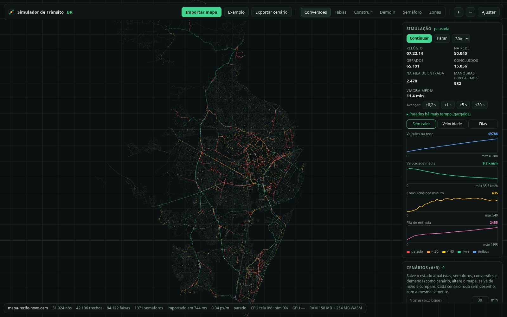
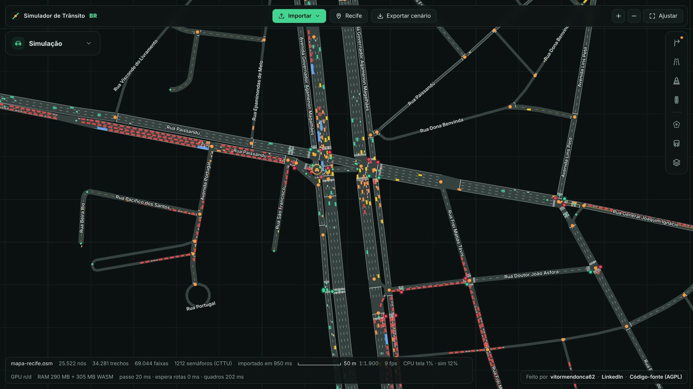
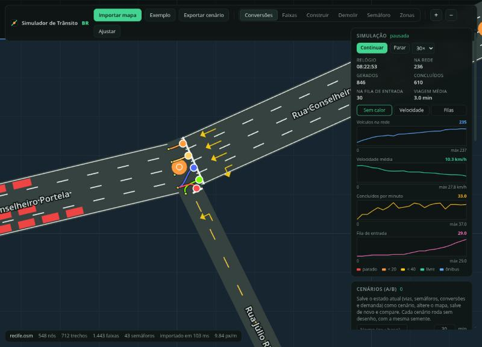
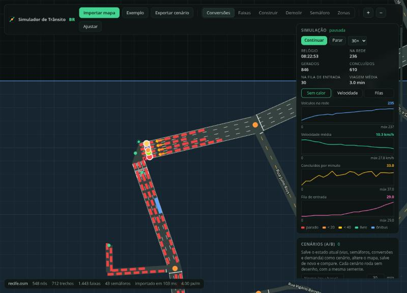
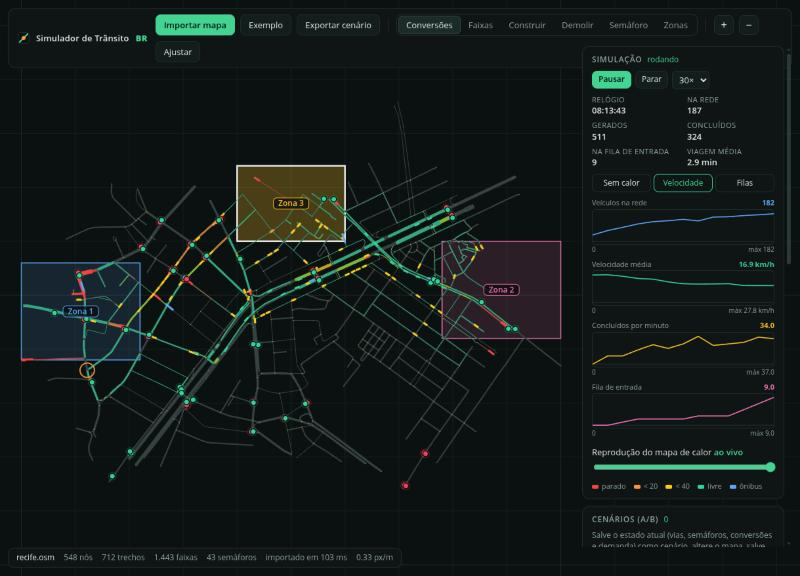
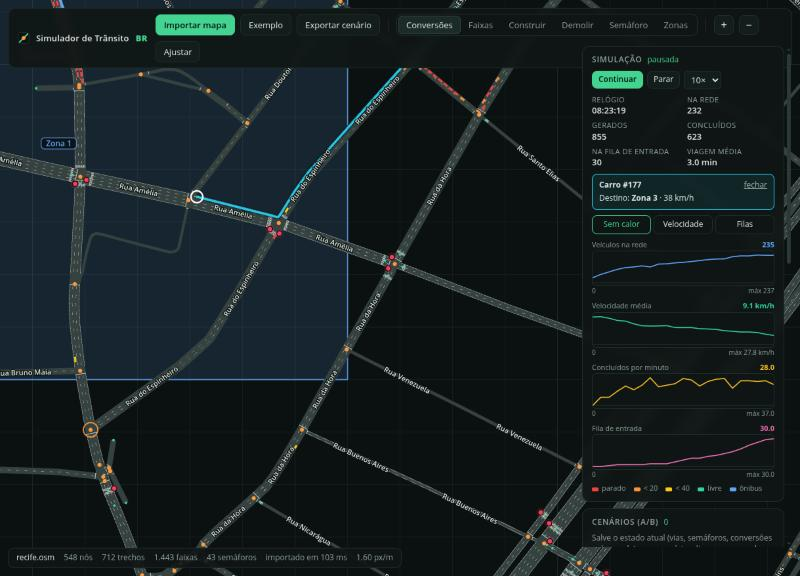
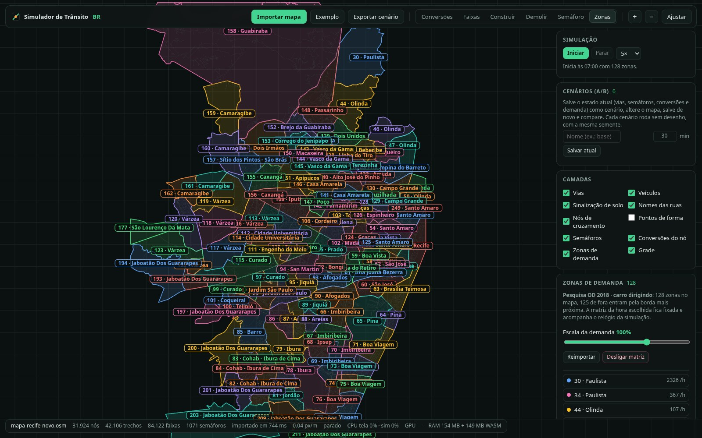
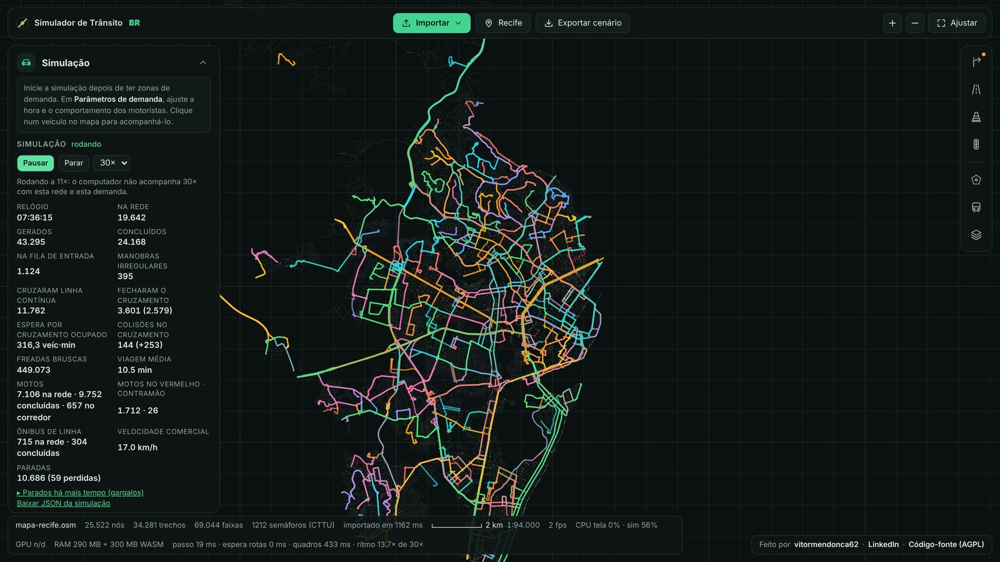
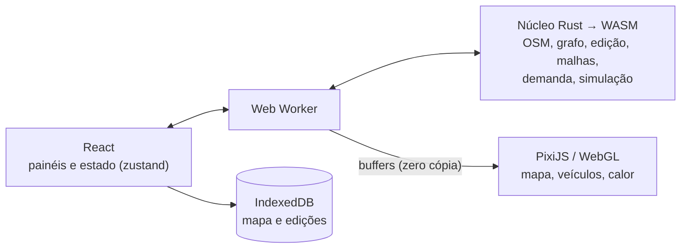

# Simulador de Trânsito BR

**Simulador de trânsito microscópico que roda inteiro no navegador, com regras brasileiras (CTB, mão direita) e dados reais do Recife.**

Feito para gestores e planejadores testarem mudanças viárias antes de executá-las: tirar ou criar uma faixa, mudar um semáforo, proibir uma conversão, abrir uma via nova, mexer numa linha de ônibus. Depois é só comparar o trânsito antes e depois. Não precisa de servidor nem de instalação: o núcleo é Rust compilado para WebAssembly e o mapa é desenhado em WebGL.

**Teste no navegador:** [simulador-transito-br.pages.dev](https://simulador-transito-br.pages.dev/)

[](LICENSE)




<sub>Pico da manhã no Recife com a demanda da Pesquisa OD 2018: 50 mil veículos na rede. Vermelho é parado, laranja até 20 km/h, amarelo até 40 km/h, verde é livre e azul é ônibus.</sub>

## Sumário

- [Início rápido](#início-rápido)
- [O que dá para fazer](#o-que-dá-para-fazer)
- [Como usar](#como-usar)
- [Dados reais do Recife](#dados-reais-do-recife)
- [Arquitetura](#arquitetura)
- [Desenvolvimento](#desenvolvimento)
- [Limitações](#limitações)
- [Fontes dos dados](#fontes-dos-dados)
- [Licença](#licença)

## Início rápido

A forma mais rápida é abrir [simulador-transito-br.pages.dev](https://simulador-transito-br.pages.dev/). Para rodar na sua máquina:

Requisitos: [Node.js](https://nodejs.org) 20.19+ ou 22.12+, [Rust](https://rustup.rs) e [`wasm-pack`](https://rustwasm.github.io/wasm-pack/).

```bash
npm install
npm run build:core   # compila o núcleo Rust para WebAssembly
npm run dev          # abre em http://localhost:5173
```

No app, clique em **Recife**. O mapa da cidade já vem com o projeto, e o app pergunta se você quer importar junto:

- as **zonas de demanda da Pesquisa OD 2018**, com as matrizes de viagens de carro e de moto;
- os **semáforos oficiais da CTTU**, no lugar dos do OpenStreetMap;
- as **linhas de ônibus do Grande Recife** (GTFS), com itinerários, paradas e horários.

Depois clique em **Iniciar** no painel **Simulação**, à esquerda. A simulação começa às 05:00 e segue o perfil horário da pesquisa.

Para outra cidade, exporte uma área em [openstreetmap.org/export](https://www.openstreetmap.org/export) ou baixe um recorte `.pbf` (Geofabrik, BBBike) e use **Importar → Mapa**.

## O que dá para fazer

**Rede viária**
- Importa mapas do OpenStreetMap (`.osm` ou `.pbf`) e monta o grafo: trechos, faixas por sentido, mão única, rotatórias, faixas de ônibus, viadutos e túneis em níveis separados, restrições de conversão.
- Desenha a via como ela é: asfalto, linha amarela dupla, faixas brancas, zebras, linha de retenção e nomes das ruas.

**Edição**
- **Conversões estilo TM:PE** (Cities: Skylines): clique num cruzamento e arraste de uma faixa de origem até uma de destino para liberar ou proibir a manobra.
- **Faixas**: número e largura de faixas, mão única, faixa de ônibus e inversão de sentido, num trecho ou na via inteira.
- **Construção e demolição**: desenhe vias novas a partir de presets (rua local, avenida 2+2, via expressa…) ou remova trechos. <kbd>Ctrl</kbd>+<kbd>Z</kbd> desfaz.
- **Semáforos**: adicione, remova e configure fases, tempos e defasagem (onda verde), em cruzamentos ou em qualquer ponto de uma via, com fase de pedestres.
- **Placas de preferência**: nos cruzamentos sem semáforo, cada ramo pode ser via preferencial, "dê a preferência" ou "pare".

**Demanda e simulação**
- **Zonas de demanda**: desenhe zonas de geração e atração. A matriz origem-destino sai de um modelo gravitacional com perfis horários, e qualquer célula pode ser fixada à mão.
- **Linhas de ônibus**: os ônibus saem nos horários do GTFS, seguem o itinerário e param nos pontos. Dá para ligar e desligar linhas, mudar a frequência por hora e criar, mover ou remover paradas (em faixa ou em baia).
- **Simulação microscópica** de carros, motos e ônibus: modelo de seguimento IDM, troca de faixa planejada pela rota, amarelo e esquerda permissiva no semáforo, preferência por aceitação de brecha, rotatórias e a regra da direita do CTB.
- **Motos**: com matriz própria da Pesquisa OD. No trânsito lento, andam no corredor entre as faixas e param na linha do semáforo à frente dos carros. Parcelas ajustáveis de motociclistas que avançam o vermelho com o cruzamento livre, usam a faixa de ônibus, cortam caminho na contramão em trechos curtos de mão única ou usam o corredor com o trânsito andando.
- **Comportamento ajustável**: % de motos (e de ônibus, quando as linhas estão desligadas), motoristas com app de navegação desviando em tempo real (estilo Waze), quem ignora a sinalização e quem "fecha o cruzamento" (CTB art. 45). Já vem com valores típicos do Recife.
- **Determinística por semente**: o mesmo cenário dá sempre o mesmo resultado.

**Análise**
- Mapa de calor de velocidade ou de filas, gráficos ao longo do tempo com replay.
- **Antes e depois**: exporte o cenário, faça a mudança e rode de novo com a mesma demanda e a mesma semente; como a simulação é determinística, a diferença vem da mudança.
- **Ônibus**: clique numa parada para ver as linhas que passam, os próximos ônibus e a espera média; clique num ônibus para ver a linha, a próxima parada e o atraso.
- **Depuração**: clique num veículo para ver rota, faixa, líder, próxima manobra e quem o está bloqueando; avance passo a passo e liste os veículos parados há mais tempo.



<sub>Agamenon Magalhães × Rua Paissandu no pico da manhã: filas nos semáforos da CTTU. Vermelho é parado, azul é ônibus.</sub>

## Como usar

**Barra superior**

| Botão | O que faz |
| --- | --- |
| **Importar → Mapa** | Abre um `.osm` ou `.pbf` e descarta as edições do mapa anterior. Também dá para arrastar o arquivo para a janela. |
| **Importar → Cenário** | Aplica um `.json` exportado (vias, faixas, semáforos, conversões, paradas e demanda) sobre o mapa aberto. |
| **Recife** | Abre o mapa do Recife que vem com o projeto, com as zonas da OD 2018, os semáforos da CTTU e as linhas de ônibus, se você quiser. |
| **Exportar cenário** | Baixa um `.json` com todas as edições. |
| **+ / − / Ajustar** | Zoom e enquadrar o mapa inteiro. A escala aparece no rodapé. |

**Painel Simulação, à esquerda.** Fica sempre aberto (pode ser recolhido): iniciar, pausar, velocidade (1× a 30×), mapa de calor, gráficos e os **parâmetros de demanda** (hora, ônibus, motos, app de navegação, infrações).

**Trilho da direita.** Cada ícone abre um painel com instruções no topo. Os ícones de edição também ligam a ferramenta correspondente no mapa.

| Painel | Para quê |
| --- | --- |
| **Conversões** | Clique num cruzamento (nó laranja) para ver e editar as manobras faixa a faixa, adicionar semáforo e definir placas de preferência. |
| **Faixas** | Clique numa via para mudar faixas, largura, mão e faixa de ônibus. |
| **Construção e demolição** | Alterne entre **Construir** (clique para cada ponto da via nova) e **Demolir** (clique no trecho). |
| **Semáforos** | Lista com busca por rua ou código CTTU. Clique num semáforo, na lista ou no mapa, para ver ciclo, fases e quando cada aproximação tem verde. **Colocar semáforo** cria um semáforo onde você clicar. |
| **Zonas de demanda** | Desenhe zonas ou importe as da Pesquisa OD 2018; veja a matriz OD e as entradas e saídas na divisa. |
| **Linhas de ônibus** | Busque linhas, ligue ou desligue, ajuste a frequência por hora e a cor. Em **Editar paradas**, clique numa via para criar uma parada ou arraste as existentes. |
| **Camadas** | Liga e desliga vias, sinalização, nomes, nós, semáforos, ônibus, veículos, zonas e grade. |

Tudo fica salvo no navegador (IndexedDB): ao reabrir, o mapa e as edições voltam como estavam.

<table>
  <tr>
    <td><br><sub>Editor de conversões: origens são os pontos maiores, destinos os menores.</sub></td>
    <td><br><sub>Carros e ônibus formando fila no semáforo.</sub></td>
  </tr>
  <tr>
    <td><br><sub>Mapa de calor de velocidade e gráficos da simulação.</sub></td>
    <td><br><sub>Rota restante, destino e estado de um veículo.</sub></td>
  </tr>
</table>

## Dados reais do Recife

O projeto traz o mapa do Recife (`public/data/mapa-recife.osm.gz`, recorte do OpenStreetMap de outubro de 2026) e três conjuntos de dados oficiais já processados. Os scripts que geram cada um estão no repositório e podem ser rodados de novo.



### Pesquisa Origem-Destino 2018

Os microdados oficiais da Pesquisa Origem-Destino Metropolitana 2018 (ICPS / Grande Recife Consórcio) viram zonas de tráfego e 24 matrizes horárias de viagens de carro.

```bash
pip install -r scripts/od_recife/requirements.txt
python scripts/od_recife/gerar_od.py
```

O script baixa os arquivos para `data/od_recife/_brutos/` e gera dois conjuntos de saídas:

- **Em `data/od_recife/`:** fluxos por zona e por bairro, os principais destinos de cada origem, o perfil horário e uma validação contra as matrizes oficiais de 2020.
- **Em `public/data/od2018_zonas.json`:** as 253 zonas e as matrizes horárias, que é o arquivo lido pelo simulador.

Ao importar, o simulador mantém as zonas que têm vias no mapa. As cidades vizinhas entram e saem por portais nas vias principais da divisa (BR-101, BR-232, Agamenon…). A matriz acompanha o relógio da simulação, e uma escala de demanda (0–150 %) ajusta o volume.

Antes de usar, considere três premissas:

- **Só trabalho e educação:** compras, saúde, táxi, aplicativo e carga ficam de fora, então o volume fica abaixo do real. As motos (motocicleta + mototáxi) entram por uma matriz própria, com a hipótese de 1 viagem = 1 moto.
- **Pessoas, não veículos:** os números são pessoas expandidas da amostra. Na categoria "carro dirigindo", um condutor equivale a um veículo.
- **Dados de 2018:** a pesquisa de 2021 não publicou matriz nem microdados.

Detalhes em [`data/od_recife/metadados_e_limitacoes.md`](data/od_recife/metadados_e_limitacoes.md).

### Semáforos da CTTU

Os semáforos vêm da base oficial da CTTU (712 pontos) e substituem os `highway=traffic_signals` do OpenStreetMap.

```bash
pip install -r scripts/semaforos_recife/requirements.txt
python scripts/semaforos_recife/gerar_semaforos.py
```

O script baixa, audita e normaliza a base, agrupa os pontos por interseção e compara com o OSM. Os relatórios ficam em `data/semaforos_recife/`; o arquivo `public/data/semaforos_cttu.json` é o lido pelo simulador.

- **Encaixe no mapa:** o núcleo (`core/src/extsig.rs`) encaixa cada ponto nos nós de cruzamento ao redor, inclusive nas pistas auxiliares, e ignora nós de passagem. Os nós de um mesmo código CTTU formam um controlador só, com o mesmo ciclo e a mesma defasagem.
- **Fases automáticas:** a via principal (maior classe e mais faixas) fica numa fase e a transversal na outra. As alças e ruas laterais entram pela direção, e o verde se divide pela capacidade de cada lado.
- **Ajustes manuais:** cruzamentos em que o encaixe automático erra, como as pistas centrais e auxiliares da Agamenon, são corrigidos à mão em [`scripts/semaforos_recife/ajustes_manuais.json`](scripts/semaforos_recife/ajustes_manuais.json). Lá ficam os nós do OSM, as fases pelo nome da via e, quando o cruzamento precisa, conversões proibidas e as setas de cada faixa.
- **Reaplicar os ajustes:** para reaplicar sem baixar nada, rode `python scripts/semaforos_recife/aplicar_ajustes.py`.

A CTTU não publica os planos semafóricos. Por isso, ciclos e tempos de verde são estimados e podem ser editados no painel **Semáforos**.

### Linhas de ônibus do Grande Recife (GTFS)

Os itinerários, as paradas e os horários vêm do GTFS oficial do Grande Recife Consórcio de Transporte. As relações `route=bus` do OpenStreetMap não são usadas: são poucas e incompletas.

```bash
pip install -r scripts/onibus_recife/requirements.txt
python scripts/onibus_recife/gerar_onibus.py
```



<sub>Linhas de ônibus do GTFS sobre o mapa e, à esquerda, as métricas da simulação: veículos na rede, motos no corredor, ônibus por linha e velocidade comercial.</sub>

O script escolhe um dia útil de referência, recorta cada itinerário pelo mapa e o casa com as vias do OSM. Na última execução foram **290 linhas** com trecho no mapa, **2.868 paradas** e 86 % dos itinerários contínuos. Os trechos em que o casamento falha são corrigidos em [`scripts/onibus_recife/ajustes_manuais.json`](scripts/onibus_recife/ajustes_manuais.json). Os números de cada execução ficam em [`data/onibus_recife/relatorio_onibus.md`](data/onibus_recife/relatorio_onibus.md), e o método em [`metodologia_onibus.md`](data/onibus_recife/metodologia_onibus.md).

### Levar para outra cidade

O mapa vem de qualquer recorte do OpenStreetMap. Os três pipelines seguem o mesmo roteiro: baixar a base aberta, auditar, normalizar, casar com o mapa e gerar um JSON que o app lê. Por isso dá para repeti-los em outra cidade que publique dados equivalentes:

- uma **pesquisa origem-destino** com zonas e microdados;
- a **localização dos semáforos**;
- o **GTFS** do transporte público.

Hoje os scripts estão escritos para as bases do Recife (nomes de colunas, códigos, ajustes manuais), então cada cidade nova pede uma adaptação.

## Arquitetura



| Parte | Tecnologia |
| --- | --- |
| Núcleo (grafo, edição, malhas, demanda, simulação, métricas) | Rust compilado para WebAssembly, num Web Worker |
| Desenho do mapa e dos veículos | PixiJS (WebGL) |
| Painéis e estado | React + zustand |
| Persistência | IndexedDB (`idb-keyval`) |

- **Desenho do mapa:** a geometria é gerada no Rust e enviada pronta. O mapa é dividido em ladrilhos de 1 km, e só os ladrilhos tocados por uma edição são regerados.
- **Simulação:** roda em passos fixos de 0,2 s dentro do worker, sem travar a interface. A meta é cerca de 50 mil veículos no navegador.

```
core/                 núcleo Rust: osm, net, conn, extsig, render, demand, sim/
src/engine/           desenho: MapView e camadas (semáforos, veículos, calor, conversões)
src/model/            estado, ponte com o worker, persistência
src/ui/               barra superior, trilho de painéis e painéis
scripts/od_recife/    pipeline da Pesquisa OD 2018
scripts/semaforos_recife/  pipeline dos semáforos da CTTU e ajustes manuais
scripts/onibus_recife/     pipeline das linhas de ônibus (GTFS) e ajustes manuais
data/                 saídas dos pipelines (CSVs, relatórios, metadados)
public/data/          mapa do Recife, zonas, semáforos e linhas lidos pelo app
docs/CONTEXT.md       decisões, medições e roadmap
```

O histórico completo das decisões, as medições de desempenho e as limitações conhecidas estão em [`docs/CONTEXT.md`](docs/CONTEXT.md).

## Desenvolvimento

```bash
npm run dev     # servidor de desenvolvimento
npm run build   # núcleo + checagem de tipos + build de produção (dist/)
npm test        # testes do núcleo (cargo test)
npm run sample  # regenera o mapa sintético de exemplo em samples/
```

Alguns testes usam o mapa real e ficam desligados por padrão. Para rodá-los, passe o caminho de um `.osm` do Recife:

```bash
RECIFE_OSM=caminho/para/mapa-recife.osm cargo test --release --manifest-path core/Cargo.toml -- --ignored --nocapture
```

Contribuições são bem-vindas: abra uma issue para discutir a mudança antes de um pull request grande.

## Limitações

- **Sem calibração com o trânsito real:** não há contagens de tráfego abertas para comparar. Os resultados servem para comparar cenários entre si, não para prever o trânsito de um dia específico.
- **Tipos de veículo:** carros, motos e ônibus; sem caminhões, carga, bicicletas nem pedestres. A fase de pedestres do semáforo apenas para os carros.
- **Demanda:** a Pesquisa OD é de 2018 e só cobre trabalho e educação (ver acima). Origem e destino dentro da zona são sorteados (faixa pelo comprimento, nó de destino ao acaso), sem dados de onde as pessoas moram ou trabalham.
- **Semáforos:** os tempos são de tempo fixo e estimados, sem detecção nem plano real. A base da CTTU dá o ponto do semáforo, não a posição de cada grupo focal no cruzamento. Os ajustes manuais usam ids de nós do OSM de 2026; num OSM muito diferente, volta o encaixe automático.
- **Mapa:** o OpenStreetMap do Recife tem lacunas (número de faixas, setas, conversões proibidas, baias). O GTFS traz 1.179 paradas sem nome, e o OSM não tem nenhuma baia de ônibus mapeada.
- **Desempenho da edição:** mudar as faixas de um trecho é rápido, mas conversões, obras e semáforos ainda reconstroem a rede inteira, o que leva centenas de milissegundos num mapa do tamanho do Recife.
- **Cenários:** um cenário só vale para o arquivo OSM em que foi criado.

## Fontes dos dados

- **Mapa:** © contribuidores do [OpenStreetMap](https://www.openstreetmap.org/copyright), licença ODbL.
- **Pesquisa Origem-Destino Metropolitana 2018:** Instituto da Cidade Pelópidas Silveira (ICPS) e Grande Recife Consórcio de Transporte, no [Portal de Dados Abertos do Recife](https://dados.recife.pe.gov.br/dataset/pesquisa-origemdestino-metropolitana-2018).
- **Linhas de ônibus:** [GTFS do Grande Recife Consórcio de Transporte](https://www.granderecife.pe.gov.br/transporte/gtfs/).
- **Semáforos:** base oficial da CTTU (Autarquia de Trânsito e Transporte Urbano do Recife), no [Portal de Dados Abertos do Recife](https://dados.recife.pe.gov.br/dataset/localizacao-dos-semaforos).
- **Limites de bairros:** Portal de Dados Abertos do Recife.

## Licença

Copyright © 2026 [VitorMendonca62](https://github.com/VitorMendonca62) · [LinkedIn](https://www.linkedin.com/in/vitormendonca62/)

O código é software livre sob a [GNU Affero General Public License v3.0](LICENSE) ou posterior (`AGPL-3.0-or-later`). Você pode usar, estudar, modificar e redistribuir, desde que as versões modificadas também sejam distribuídas sob a AGPL. Isso inclui oferecer o simulador como serviço pela rede: quem roda uma versão modificada para outras pessoas usarem precisa disponibilizar o código-fonte dela.

Para uso comercial sem as obrigações da AGPL (por exemplo, incorporar o simulador num produto fechado), fale com o autor sobre uma licença comercial.

Os dados em `public/data/` e `data/` não são cobertos por esta licença e seguem as licenças das fontes acima. O mapa do OpenStreetMap, por exemplo, segue a ODbL.
