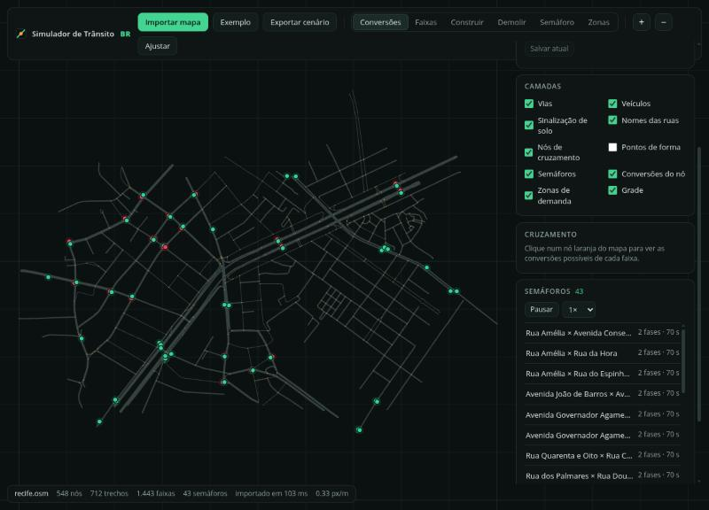
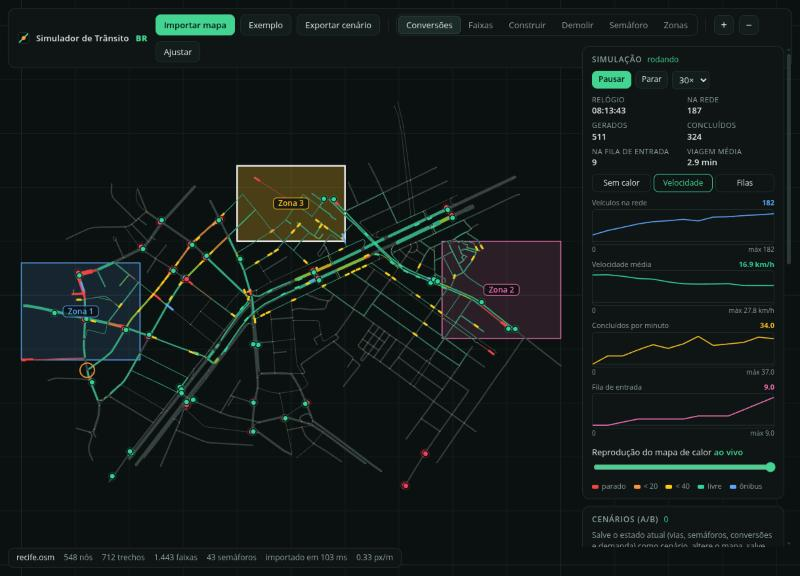
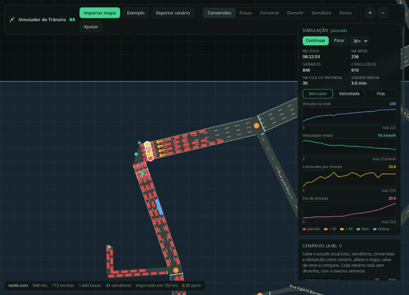
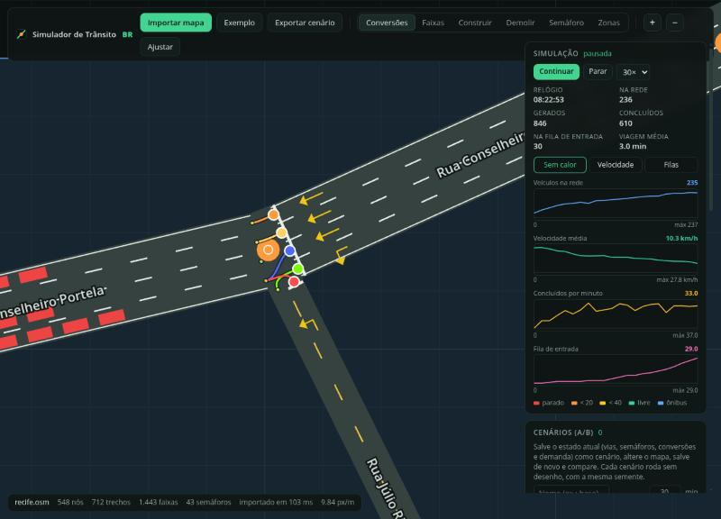
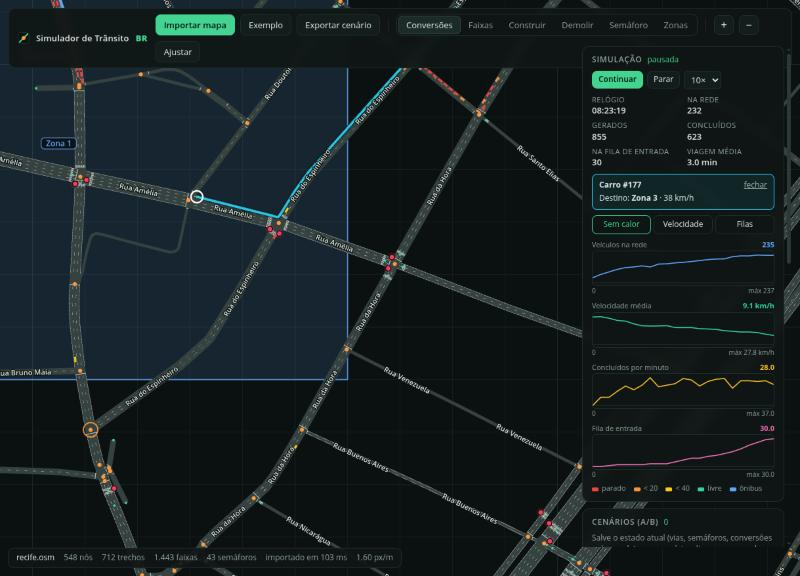

# Simulador de Trânsito BR

Simulador de trânsito no navegador, com comportamento brasileiro, para gerentes e planejadores testarem mudanças viárias (faixas, semáforos, conversões, vias novas) e compararem o impacto no trânsito. Roda 100% no navegador, sem servidor.

As imagens abaixo usam um recorte real do **Recife** (centro, região da Av. Agamenon Magalhães) importado do OpenStreetMap: 548 nós, 712 trechos, 1.443 faixas e 43 semáforos.



## O que faz

- **Importa mapas do OpenStreetMap** (`.osm` ou `.pbf`) e monta o grafo viário: trechos, faixas por sentido, semáforos, rotatórias, faixas de ônibus, mão única, restrições de conversão.
- **Desenha a via como ela é**: asfalto, sinalização de solo (linha amarela dupla, faixas brancas, zebras, retenção), nomes de ruas.
- **Editor de conversões estilo TM:PE**: clique num cruzamento e arraste de uma faixa de origem para uma de destino para permitir ou proibir manobras.
- **Editor de vias**: número e largura de faixas, mão única, faixa de ônibus; construir vias novas e demolir trechos.
- **Semáforos**: adicionar, remover e configurar fases, tempos e defasagem, em cruzamentos ou em qualquer ponto de uma via (com fase de pedestres).
- **Placas de preferência**: em cruzamentos sem semáforo, defina para cada ramo se é via preferencial, "dê a preferência" ou "pare" (ou deixe automático pela hierarquia da via).
- **Demanda por zonas**: desenhe zonas de geração e atração de viagens. A matriz origem-destino sai de um modelo gravitacional, com perfis horários, e qualquer célula pode ser fixada à mão.
- **Dados reais do Recife**: importe as zonas de tráfego e a matriz de carro da **Pesquisa Origem-Destino Metropolitana 2018** (ver [Dados reais do Recife](#dados-reais-do-recife-pesquisa-od-2018)).
- **Simulação microscópica** de carros e ônibus:
  - roteamento por faixa, com troca de faixa planejada;
  - semáforo com amarelo e esquerda permissiva;
  - preferência por brecha, rotatória e a regra da direita do CTB;
  - motoristas que desrespeitam a sinalização (opcional).

  É determinística por semente: o mesmo cenário dá o mesmo resultado.
- **Análise**: mapa de calor (velocidade ou filas), gráficos no tempo com replay e comparação A/B de cenários.
- **Depuração**: clique num veículo para ver o estado completo. Aparecem a rota, a faixa, o líder, a próxima manobra, se ele pode entrar no cruzamento e quem está bloqueando. Dá para avançar a simulação passo a passo e listar os veículos parados há mais tempo. A barra de status mostra quadros por segundo, CPU, GPU e memória.

### Simulação e mapa de calor

Vermelho é parado, laranja é lento e verde é fluxo livre. Os gráficos acompanham veículos na rede, velocidade média, concluídos por minuto e fila de entrada.



### Filas num semáforo

Carros e ônibus respeitam o semáforo e formam filas. Os quadrados são veículos (cor pela velocidade).



### Editor de conversões

Clique num cruzamento: as origens são os pontos maiores e os destinos os menores. Arraste para criar uma conversão e clique numa curva para removê-la.



### Rota de um veículo

Clique num carro ou ônibus para ver o caminho que ele ainda vai percorrer, o destino, a velocidade e há quanto tempo está parado.



### Comparação de cenários (A/B)

Salve o estado atual como cenário, altere o mapa (por exemplo, tire uma faixa de uma avenida), salve de novo e compare. Cada cenário roda sem desenho, com a mesma semente, e a comparação mostra vazão, atraso total, filas e os cruzamentos mais afetados.

## Como rodar

Requisitos: Node.js, [Rust](https://rustup.rs) e [`wasm-pack`](https://rustwasm.github.io/wasm-pack/).

```bash
npm install
npm run build:core   # compila o núcleo Rust para WebAssembly
npm run dev          # abre em http://localhost:5173
```

Clique em **Importar mapa** (`.osm`, `.pbf`) ou em **Exemplo** para o mapa sintético. Para um recorte real, exporte uma área em [openstreetmap.org](https://www.openstreetmap.org/export) (até alguns km²) e importe o arquivo.

Outros comandos:

```bash
npm run build   # núcleo + checagem de tipos + build de produção
npm test        # testes do núcleo Rust (cargo test)
npm run sample  # regenera o mapa de exemplo em samples/
```

## Como usar

1. **Conversões**: selecione cruzamentos, edite manobras e semáforos.
2. **Faixas**: selecione uma via e altere faixas, largura, sentido e faixa de ônibus.
3. **Construir** e **Demolir**: crie vias novas (presets de via) ou remova trechos.
4. **Semáforo**: clique em qualquer ponto de uma via para colocar um semáforo.
5. **Zonas**: desenhe ao menos duas zonas e ajuste geração, atração e perfil. A matriz OD aparece no painel. Com um mapa do Recife, use **Importar zonas da Pesquisa OD 2018**.
6. **Simulação**: **Iniciar**, escolha a velocidade (1× a 30×), ligue o mapa de calor e clique nos veículos.
7. **Cenários**: salve, altere e compare. Tudo é guardado no navegador (IndexedDB) e pode ser exportado em JSON.

## Dados reais do Recife (Pesquisa OD 2018)

O projeto traz um pipeline reproduzível que transforma os microdados oficiais da Pesquisa Origem-Destino Metropolitana 2018 (ICPS / Grande Recife Consórcio, publicados no [Portal de Dados Abertos do Recife](https://dados.recife.pe.gov.br/dataset/pesquisa-origemdestino-metropolitana-2018)) em demanda para o simulador.

```bash
pip install -r scripts/od_recife/requirements.txt
python scripts/od_recife/gerar_od.py
```

O script baixa os arquivos oficiais para `data/od_recife/_brutos/` e gera:

- **Em `data/od_recife/`:**
  - fluxos origem-destino de carro por zona de tráfego e por bairro (pico da manhã, pico da tarde e dia útil);
  - os 10 principais destinos de cada origem;
  - matrizes OD e o perfil horário;
  - a correspondência zona × bairro;
  - uma validação contra as matrizes oficiais de 2020.
- **`public/data/od2018_zonas.json`:** as 253 zonas de tráfego e 24 matrizes horárias de carro dirigindo, lidas pelo simulador.

No painel **Zonas**, **Importar zonas da Pesquisa OD 2018** faz o seguinte:

- mantém as zonas que têm vias no mapa carregado, recortadas à área da rede;
- incorpora as demais à zona de borda mais próxima;
- fixa a matriz da hora escolhida, que acompanha o relógio da simulação;
- oferece uma **escala de demanda** (0–150%) para calibrar o volume.

Premissas importantes:

- **Unidades e veículos:** os números são pessoas expandidas da amostra. Para "carro dirigindo", um condutor equivale a um veículo.
- **O que a matriz cobre:** só viagens de **trabalho e educação**. Compras, saúde, serviços, motos, táxi, aplicativo e carga ficam de fora, então o volume fica abaixo do tráfego real.
- **Ano:** os dados são de 2018. A pesquisa OD do Recife de 2021 não publicou matriz nem microdados.

Fontes, definições de colunas, filtros e limitações estão em [`data/od_recife/metadados_e_limitacoes.md`](data/od_recife/metadados_e_limitacoes.md).

## Arquitetura

| Parte | Tecnologia |
| --- | --- |
| Núcleo (grafo, edição, malhas, simulação, métricas) | Rust compilado para WebAssembly, rodando num Web Worker |
| Desenho do mapa e veículos | PixiJS (WebGL) |
| Painéis e estado | React + zustand |
| Persistência | IndexedDB (`idb-keyval`) |

O mapa é desenhado em ladrilhos de 1 km que só são regerados onde houve edição, e a simulação roda em passos fixos de 0,2 s na própria thread do worker, sem travar a interface. A meta é cerca de 50 mil veículos no navegador.

Estrutura:

```
core/        núcleo Rust (osm, net, conn, render, demand, sim/)
src/engine/  desenho (MapView, camadas de semáforo, veículos, calor, conversões)
src/model/   estado, ponte com o worker, persistência
src/ui/      painéis
docs/        CONTEXT.md (decisões e roadmap) e imagens
scripts/     mapa de exemplo e pipeline da Pesquisa OD 2018 (od_recife/)
data/        saídas da Pesquisa OD 2018 (CSVs e metadados)
public/data/ zonas e matrizes horárias lidas pelo simulador
```

Contexto completo, decisões, medições de desempenho e limitações conhecidas em [`docs/CONTEXT.md`](docs/CONTEXT.md).

## Limitações atuais

- Só carros e ônibus; sem motos, caminhões nem pedestres (a fase de pedestres do semáforo só interrompe os carros).
- Dentro de cada zona, o veículo nasce numa faixa sorteada pelo comprimento e termina num nó sorteado, sem dados de onde as pessoas moram ou trabalham. Em mapas grandes com muitas zonas, cada zona fica com um único nó de destino.
- Com a Pesquisa OD, o tráfego que vem de fora do mapa nasce espalhado pela zona de borda, e não nas vias por onde de fato entraria.
- Ainda não há linhas de ônibus com paradas.
- Cada edição reconstrói a rede inteira (cerca de 200 ms no mapa de teste de 22 mil nós; a meta é 100 ms).
- Um cenário só vale para o arquivo OSM com que foi criado.

## Dados

O recorte do Recife vem do OpenStreetMap © contribuidores do OpenStreetMap, licença [ODbL](https://www.openstreetmap.org/copyright).

A Pesquisa Origem-Destino Metropolitana 2018 é do Instituto da Cidade Pelópidas Silveira (ICPS) e do Grande Recife Consórcio de Transporte, publicada pela Prefeitura do Recife no Portal de Dados Abertos. Os limites de bairros vêm do mesmo portal.
