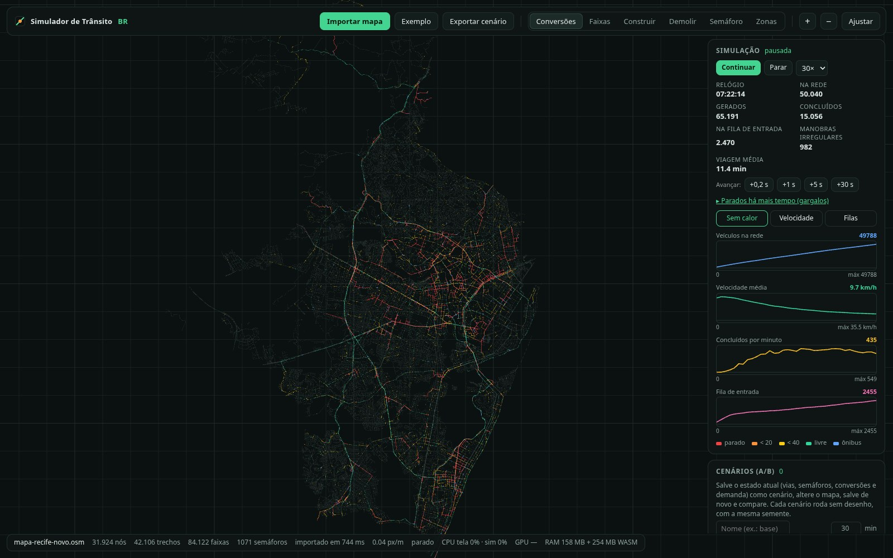
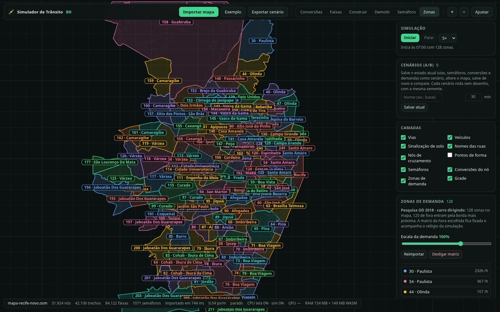
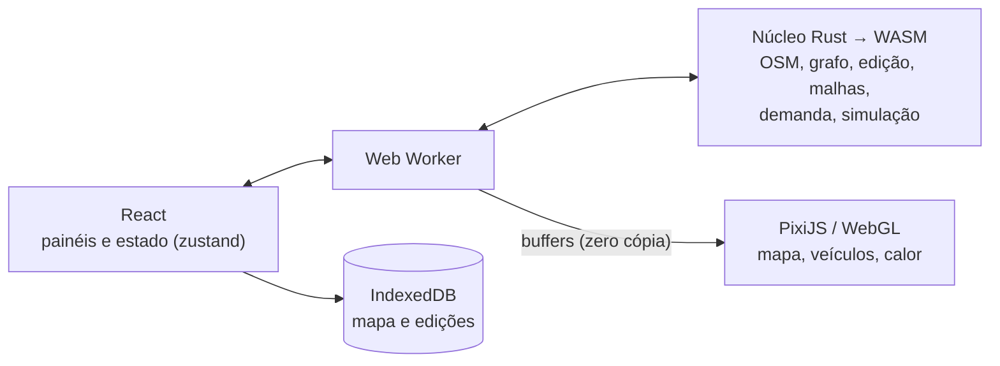

# Simulador de Trânsito BR

**Simulador de trânsito microscópico que roda inteiro no navegador, com regras brasileiras (CTB, mão direita) e dados reais do Recife.**

Feito para gestores e planejadores testarem mudanças viárias antes de executá-las: tirar ou criar uma faixa, mudar um semáforo, proibir uma conversão, abrir uma via nova. Depois é só comparar o trânsito antes e depois. Não precisa de servidor nem de instalação: o núcleo é Rust compilado para WebAssembly e o mapa é desenhado em WebGL.

[](LICENSE)




<sub>Pico da manhã no Recife com a demanda da Pesquisa OD 2018: 50 mil veículos na rede. Vermelho é parado, laranja até 20 km/h, amarelo até 40 km/h, verde é livre e azul é ônibus.</sub>

## Sumário

- [Início rápido](#início-rápido)
- [O que dá para fazer](#o-que-dá-para-fazer)
- [Como usar](#como-usar)
- [Dados reais do Recife](#dados-reais-do-recife)
- [Arquitetura](#arquitetura)
- [Desenvolvimento](#desenvolvimento)
- [Limitações](#limitações)
- [Fontes dos dados](#fontes-dos-dados)
- [Licença](#licença)

## Início rápido

Requisitos: [Node.js](https://nodejs.org) 20.19+ ou 22.12+, [Rust](https://rustup.rs) e [`wasm-pack`](https://rustwasm.github.io/wasm-pack/).

```bash
npm install
npm run build:core   # compila o núcleo Rust para WebAssembly
npm run dev          # abre em http://localhost:5173
```

No app, clique em **Recife**. O mapa da cidade já vem com o projeto, e o app pergunta se você quer importar junto:

- as **zonas de demanda da Pesquisa OD 2018**, com a matriz de viagens de carro;
- os **semáforos oficiais da CTTU**, no lugar dos do OpenStreetMap.

Depois abra **Simulação** no trilho da direita e clique em **Iniciar**. A simulação começa às 05:00 e segue o perfil horário da pesquisa.

Para outra cidade, exporte uma área em [openstreetmap.org/export](https://www.openstreetmap.org/export) ou baixe um recorte `.pbf` (Geofabrik, BBBike) e use **Importar → Mapa**.

## O que dá para fazer

**Rede viária**
- Importa mapas do OpenStreetMap (`.osm` ou `.pbf`) e monta o grafo: trechos, faixas por sentido, mão única, rotatórias, faixas de ônibus, viadutos e túneis em níveis separados, restrições de conversão.
- Desenha a via como ela é: asfalto, linha amarela dupla, faixas brancas, zebras, linha de retenção e nomes das ruas.

**Edição**
- **Conversões estilo TM:PE** (Cities: Skylines): clique num cruzamento e arraste de uma faixa de origem até uma de destino para liberar ou proibir a manobra.
- **Faixas**: número e largura de faixas, mão única, faixa de ônibus e inversão de sentido, num trecho ou na via inteira.
- **Construção e demolição**: desenhe vias novas a partir de presets (rua local, avenida 2+2, via expressa…) ou remova trechos. <kbd>Ctrl</kbd>+<kbd>Z</kbd> desfaz.
- **Semáforos**: adicione, remova e configure fases, tempos e defasagem (onda verde), em cruzamentos ou em qualquer ponto de uma via, com fase de pedestres.
- **Placas de preferência**: nos cruzamentos sem semáforo, cada ramo pode ser via preferencial, "dê a preferência" ou "pare".

**Demanda e simulação**
- **Zonas de demanda**: desenhe zonas de geração e atração. A matriz origem-destino sai de um modelo gravitacional com perfis horários, e qualquer célula pode ser fixada à mão.
- **Simulação microscópica** de carros e ônibus: modelo de seguimento IDM, troca de faixa planejada pela rota, amarelo e esquerda permissiva no semáforo, preferência por aceitação de brecha, rotatórias e a regra da direita do CTB.
- **Comportamento ajustável**: % de ônibus, motoristas com app de navegação desviando em tempo real (estilo Waze), quem ignora a sinalização e quem "fecha o cruzamento" (CTB art. 45). Já vem com valores típicos do Recife.
- **Determinística por semente**: o mesmo cenário dá sempre o mesmo resultado.

**Análise**
- Mapa de calor de velocidade ou de filas, gráficos ao longo do tempo com replay.
- **Cenários A/B**: salve o estado atual, altere o mapa, salve de novo e compare vazão, atraso, filas e os cruzamentos mais afetados, com a mesma demanda e semente.
- **Depuração**: clique num veículo para ver rota, faixa, líder, próxima manobra e quem o está bloqueando; avance passo a passo e liste os veículos parados há mais tempo.

## Como usar

**Barra superior**

| Botão | O que faz |
| --- | --- |
| **Importar → Mapa** | Abre um `.osm` ou `.pbf` e descarta as edições do mapa anterior. Também dá para arrastar o arquivo para a janela. |
| **Importar → Cenário** | Aplica um `.json` exportado (vias, faixas, semáforos, conversões e demanda) sobre o mapa aberto. |
| **Recife** | Abre o mapa do Recife que vem com o projeto, com as zonas da OD 2018 e os semáforos da CTTU, se você quiser. |
| **Exportar cenário** | Baixa um `.json` com todas as edições. |
| **+ / − / Ajustar** | Zoom e enquadrar o mapa inteiro. A escala aparece no rodapé. |

**Trilho da direita.** Cada ícone abre um painel com instruções no topo. Os ícones de edição também ligam a ferramenta correspondente no mapa.

| Painel | Para quê |
| --- | --- |
| **Conversões** | Clique num cruzamento (nó laranja) para ver e editar as manobras faixa a faixa, adicionar semáforo e definir placas de preferência. |
| **Faixas** | Clique numa via para mudar faixas, largura, mão e faixa de ônibus. |
| **Construção e demolição** | Alterne entre **Construir** (clique para cada ponto da via nova) e **Demolir** (clique no trecho). |
| **Semáforos** | Lista com busca por rua ou código CTTU. Clique num semáforo, na lista ou no mapa, para ver ciclo, fases e quando cada aproximação tem verde. **Colocar semáforo** cria um semáforo onde você clicar. |
| **Zonas de demanda** | Desenhe zonas ou importe as da Pesquisa OD 2018; veja a matriz OD e as entradas e saídas na divisa. |
| **Simulação** | Iniciar, pausar, velocidade (1× a 30×), mapa de calor, gráficos e os **parâmetros de demanda** (hora, ônibus, app de navegação, infrações). |
| **Cenários A/B** | Salve, altere e compare cenários. |
| **Camadas** | Liga e desliga vias, sinalização, nomes, nós, semáforos, veículos, zonas e grade. |

Tudo fica salvo no navegador (IndexedDB): ao reabrir, o mapa e as edições voltam como estavam.

<table>
  <tr>
    <td><br><sub>Editor de conversões: origens são os pontos maiores, destinos os menores.</sub></td>
    <td><br><sub>Carros e ônibus formando fila no semáforo.</sub></td>
  </tr>
  <tr>
    <td><br><sub>Mapa de calor de velocidade e gráficos da simulação.</sub></td>
    <td><br><sub>Rota restante, destino e estado de um veículo.</sub></td>
  </tr>
</table>

## Dados reais do Recife

O projeto traz o mapa do Recife (`public/data/mapa-recife.osm.gz`, recorte do OpenStreetMap de outubro de 2026) e dois conjuntos de dados oficiais já processados. Os scripts que geram cada um estão no repositório e podem ser rodados de novo.



### Pesquisa Origem-Destino 2018

Os microdados oficiais da Pesquisa Origem-Destino Metropolitana 2018 (ICPS / Grande Recife Consórcio) viram zonas de tráfego e 24 matrizes horárias de viagens de carro.

```bash
pip install -r scripts/od_recife/requirements.txt
python scripts/od_recife/gerar_od.py
```

O script baixa os arquivos para `data/od_recife/_brutos/` e gera dois conjuntos de saídas:

- **Em `data/od_recife/`:** fluxos por zona e por bairro, os principais destinos de cada origem, o perfil horário e uma validação contra as matrizes oficiais de 2020.
- **Em `public/data/od2018_zonas.json`:** as 253 zonas e as matrizes horárias, que é o arquivo lido pelo simulador.

Ao importar, o simulador mantém as zonas que têm vias no mapa. As cidades vizinhas entram e saem por portais nas vias principais da divisa (BR-101, BR-232, Agamenon…). A matriz acompanha o relógio da simulação, e uma escala de demanda (0–150 %) ajusta o volume.

Antes de usar, considere três premissas:

- **Só trabalho e educação:** compras, saúde, motos, táxi, aplicativo e carga ficam de fora, então o volume fica abaixo do real.
- **Pessoas, não veículos:** os números são pessoas expandidas da amostra. Na categoria "carro dirigindo", um condutor equivale a um veículo.
- **Dados de 2018:** a pesquisa de 2021 não publicou matriz nem microdados.

Detalhes em [`data/od_recife/metadados_e_limitacoes.md`](data/od_recife/metadados_e_limitacoes.md).

### Semáforos da CTTU

Os semáforos vêm da base oficial da CTTU (712 pontos) e substituem os `highway=traffic_signals` do OpenStreetMap.

```bash
pip install -r scripts/semaforos_recife/requirements.txt
python scripts/semaforos_recife/gerar_semaforos.py
```

O script baixa, audita e normaliza a base, agrupa os pontos por interseção e compara com o OSM. Os relatórios ficam em `data/semaforos_recife/`; o arquivo `public/data/semaforos_cttu.json` é o lido pelo simulador.

- **Encaixe no mapa:** o núcleo (`core/src/extsig.rs`) encaixa cada ponto nos nós do mapa. Os nós de um mesmo código CTTU formam um controlador só, com o mesmo ciclo e a mesma defasagem.
- **Ajustes manuais:** cruzamentos em que o encaixe automático erra, como as pistas centrais e auxiliares da Agamenon, são corrigidos à mão em [`scripts/semaforos_recife/ajustes_manuais.json`](scripts/semaforos_recife/ajustes_manuais.json). Lá ficam os nós do OSM e as fases pelo nome da via.
- **Reaplicar os ajustes:** para reaplicar sem baixar nada, rode `python scripts/semaforos_recife/aplicar_ajustes.py`.

A CTTU não publica os planos semafóricos. Por isso, ciclos e tempos de verde são estimados e podem ser editados no painel **Semáforos**.

## Arquitetura



| Parte | Tecnologia |
| --- | --- |
| Núcleo (grafo, edição, malhas, demanda, simulação, métricas) | Rust compilado para WebAssembly, num Web Worker |
| Desenho do mapa e dos veículos | PixiJS (WebGL) |
| Painéis e estado | React + zustand |
| Persistência | IndexedDB (`idb-keyval`) |

- **Desenho do mapa:** a geometria é gerada no Rust e enviada pronta. O mapa é dividido em ladrilhos de 1 km, e só os ladrilhos tocados por uma edição são regerados.
- **Simulação:** roda em passos fixos de 0,2 s dentro do worker, sem travar a interface. A meta é cerca de 50 mil veículos no navegador.

```
core/                 núcleo Rust: osm, net, conn, extsig, render, demand, sim/
src/engine/           desenho: MapView e camadas (semáforos, veículos, calor, conversões)
src/model/            estado, ponte com o worker, persistência
src/ui/               barra superior, trilho de painéis e painéis
scripts/od_recife/    pipeline da Pesquisa OD 2018
scripts/semaforos_recife/  pipeline dos semáforos da CTTU e ajustes manuais
data/                 saídas dos pipelines (CSVs, relatórios, metadados)
public/data/          mapa do Recife, zonas e semáforos lidos pelo app
docs/CONTEXT.md       decisões, medições e roadmap
```

O histórico completo das decisões, as medições de desempenho e as limitações conhecidas estão em [`docs/CONTEXT.md`](docs/CONTEXT.md).

## Desenvolvimento

```bash
npm run dev     # servidor de desenvolvimento
npm run build   # núcleo + checagem de tipos + build de produção (dist/)
npm test        # testes do núcleo (cargo test)
npm run sample  # regenera o mapa sintético de exemplo em samples/
```

Alguns testes usam o mapa real e ficam desligados por padrão. Para rodá-los, passe o caminho de um `.osm` do Recife:

```bash
RECIFE_OSM=caminho/para/mapa-recife.osm cargo test --release --manifest-path core/Cargo.toml -- --ignored --nocapture
```

Contribuições são bem-vindas: abra uma issue para discutir a mudança antes de um pull request grande.

## Limitações

- **Tipos de veículo:** só carros e ônibus; sem motos, caminhões nem pedestres. A fase de pedestres do semáforo apenas para os carros.
- **Ônibus:** ainda não há linhas com paradas.
- **Origem e destino dentro da zona:** são sorteados (faixa pelo comprimento, nó de destino ao acaso), sem dados de onde as pessoas moram ou trabalham.
- **Semáforos:** os tempos são de tempo fixo e estimados, sem detecção nem plano real. Os ajustes manuais da CTTU usam ids de nós do OSM de 2026; num OSM muito diferente, volta o encaixe automático.
- **Desempenho da edição:** cada edição reconstrói a rede inteira. Leva centenas de milissegundos num mapa do tamanho do Recife.
- **Cenários:** um cenário só vale para o arquivo OSM em que foi criado.

## Fontes dos dados

- **Mapa:** © contribuidores do [OpenStreetMap](https://www.openstreetmap.org/copyright), licença ODbL.
- **Pesquisa Origem-Destino Metropolitana 2018:** Instituto da Cidade Pelópidas Silveira (ICPS) e Grande Recife Consórcio de Transporte, no [Portal de Dados Abertos do Recife](https://dados.recife.pe.gov.br/dataset/pesquisa-origemdestino-metropolitana-2018).
- **Semáforos:** base oficial da CTTU (Autarquia de Trânsito e Transporte Urbano do Recife), no [Portal de Dados Abertos do Recife](https://dados.recife.pe.gov.br/dataset/localizacao-dos-semaforos).
- **Limites de bairros:** Portal de Dados Abertos do Recife.

## Licença

Copyright © 2026 [VitorMendonca62](https://github.com/VitorMendonca62) · [LinkedIn](https://www.linkedin.com/in/vitormendonca62/)

O código é software livre sob a [GNU Affero General Public License v3.0](LICENSE) ou posterior (`AGPL-3.0-or-later`). Você pode usar, estudar, modificar e redistribuir, desde que as versões modificadas também sejam distribuídas sob a AGPL. Isso inclui oferecer o simulador como serviço pela rede: quem roda uma versão modificada para outras pessoas usarem precisa disponibilizar o código-fonte dela.

Para uso comercial sem as obrigações da AGPL (por exemplo, incorporar o simulador num produto fechado), fale com o autor sobre uma licença comercial.

Os dados em `public/data/` e `data/` não são cobertos por esta licença e seguem as licenças das fontes acima. O mapa do OpenStreetMap, por exemplo, segue a ODbL.
